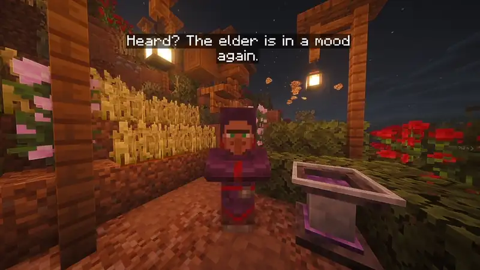

# Storybound guide for modpack authors

Storybound lets you add a story to a modpack: quests, NPCs who talk, letters and books the player can read, a Codex
of creatures, bosses and waypoints. You write the story as JSON files or build it in the in-game editor. The server
runs the story, and players follow it in the Adventure Menu (the J key), on the HUD and in dialogue screens.



Install the mod on the server and on every client.

| Page | What it covers |
| --- | --- |
| [Logic](logic.md) | Flags and variables, parties, and the "when, if, then" rules behind everything: triggers, conditions, actions, story events |
| [Quests](quests.md) | Stages, objectives, rewards, difficulty, time limits, hints |
| [Dialogues](dialogues.md) | Conversations, which mobs are NPCs, the camera, speech bubbles |
| [Documents, Codex and bosses](documents-codex.md) | Books and letters, the Journal, Codex entries, boss records |
| [Waypoints](waypoints.md) | Waypoints for quests and places, map mods, markers in the world |
| [Texts and languages](languages.md) | Translation keys, language files, long texts |
| [Tools](tools.md) | The editor, commands, finding out why something did not happen, checking a story without playing, settings |
| [Integrations](integrations.md) | KubeJS, JEI, Cutscene API, map and camera mods, Easy NPC |
| [Resource packs](resource-packs.md) | Changing how the Adventure Menu, documents and waypoint markers look |

## Getting started

1. Install Storybound (NeoForge 1.21.1) and start the game once. This creates the story folder,
   `config/storybound/`, with an empty story and four blank documents.
2. Try a scenario first (see below). Play it, then open it in the editor to see how it is made: press J, then click
   Dev Mode.
3. Write your own files in the story folder and run `/reload`. If something is wrong, `/storybound debug validate`
   lists the problems. They are also written to the log and to `logs/storybound-validation.txt`.

## The story that comes with the mod

Storybound comes with a story of its own for vanilla Minecraft. When you create a world, the Game tab has
**Story: Yes / No** under "Allow Commands" (Yes by default). With Yes, that world plays the mod's story; you can turn
it on or off later with `/gamerule storyboundStory true|false`. Worlds made before, and dedicated servers, start with
it off.

To change the story, open the stories list in the editor and click **⬇ Install**, or run
`/storybound story install vanilla`. It is copied into your story folder as a story of its own, and the world plays
your copy from then on.

## Trying a scenario

A new story folder is empty, so nothing happens in the game until you write something. To see how a feature works, an
operator can install a small ready-made story, called a scenario:

```
/storybound debug scenario <name>     install a scenario, reload and start it next to you
/storybound debug scenario clear      remove all scenarios
```

Once a scenario starts, the chat tells you what to do. Its files go into your story folder under the namespace
`scenario` (for example `dialogues/scenario/campfire/`). Open them, read them and copy what you need into your own
story. `clear` removes only the scenario files and leaves yours alone.

Play the fights in survival mode. In creative, hostile mobs ignore you.

| Scenario | What you will see |
| --- | --- |
| `campfire` | Brann the golem tells you a story in subtitles. When monsters attack, he stops to fight and then picks the story up again ("So. Where was I..."). He comments on your kills, and if a fight starts while you are choosing an answer, he asks the question again afterwards. |
| `dimensions` | Reach a Nether fortress and come back. The pinned quest has waypoints in the Overworld, the Nether and the End. Each one shows only in its own dimension, and the quest tracker names the dimensions where the others are. |
| `duel` | Ataman Grom comes for you and taunts you in subtitles all through the fight, and you answer him. Your hits don't stop the talk, and when he falls he has last words. |
| `raid` | On the next night three raiders come with a "!" marker, and a quest asks you to drive them all off. Raids come back, but not more often than every two minutes of play: the story event has a cooldown. The quest counts only the raiders the event spawned, and only when none of them is left nearby. |
| `scene` | A scene of three shots plays at once: the camera circles you with black bars and a chapter title, comes close for a line, then glides up and away. You can't move or skip it, and nothing can hurt you meanwhile. The quest waits for its end. |
| `reputation` | Hilda the baker remembers how you treat her. Praise raises her opinion of you and rudeness lowers it. Help her fight off the husks within a minute and it goes up even more; fail and it drops. You see it change as stars and skulls on the HUD. |
| `village` | A waypoint leads you to the nearest village. There every villager becomes an NPC with a name from a list. Smiths chat about their work, about three in ten grown-ups become guards, and the mod picks one villager as Elder Miron, whom the waypoint then follows. His conversation has choices that give quests (zombies at night, bread to hand in, a lamb in a search area, a dragon hunt across three stages) and an old map that costs 5 emeralds. You also start with a letter, a reward to claim in the Journal, Codex entries for eight mobs and pages for four bosses. |

## Where files go

A story is a folder inside `config/storybound/` with a `project.json` file in it. Everything that belongs to the
story lives in that folder, and you can keep several stories side by side.

Each part of a story (a quest, a dialogue, an NPC) is one JSON file. The folder it is in tells Storybound what kind
of thing it is, and its path becomes its id:

```
config/storybound/
  README.txt
  my_story/
    project.json                                 the story's settings
    quests/mypack/wolf_hunt.json                 the quest mypack:wolf_hunt
    quests/wolf_hunt.json                        the quest storybound:wolf_hunt
    dialogues/  npc_bindings/  documents/  codex/  bosses/  waypoints/
    events/  flags/  migrations/  scripts/
    chapters/  dialogue_layouts/  kubejs/        written by the editor
    lang/en_us.json  lang/ru_ru.json             short texts
    texts/en_us/mypack/elder_letter.sbt          long texts, such as letters
  scenarios/                                     installed scenarios
```

A file outside a namespace folder, like `quests/wolf_hunt.json`, gets the namespace `storybound`. The `kubejs/` folder
only appears when KubeJS is installed.

Only enabled stories are loaded. Put `"enabled": false` in `project.json` to keep a story out of the game. Two loaded
stories can't use the same id.

You can also ship the same files in a datapack, under `data/<namespace>/storybound/<kind>/`, and the texts in a
resource pack, under `assets/<namespace>/lang/` and `assets/<namespace>/storybound/texts/<language>/`. When a file in
the story folder has the same id as one in a datapack, the one in the story folder is used.

On a dedicated server the story folder is on the server. In singleplayer it is in your own game folder.

Ids use lowercase letters, digits and `_ . - /`. When you write a logic type without a namespace, Storybound assumes
its own: `"type": "flag"` means `"type": "storybound:flag"`. Types added by other mods need their namespace.

## Schemas for your editor

The `schemas/` folder of the repository has a JSON schema for every kind of file. In VS Code, copy
`schemas/vscode-settings.example.json` into your workspace settings, and you get completion, descriptions and error
marks as you type. The in-game editor builds its forms from the same schemas.

## project.json

```json
{
  "title": "Wolves of the North",
  "source_language": "en_us",
  "languages": ["en_us", "ru_ru"],
  "difficulty": { "style": "stars" },
  "track_given_quests": true
}
```

| Key | What it does |
| --- | --- |
| `title` | The story's name, shown in the editor's list of stories. |
| `enabled` | Whether the story is loaded. On unless set to `false`. |
| `source_language` | The language you write the story in. The editor shows it under texts that are not translated yet. |
| `languages` | The languages you can edit in the editor. |
| `namespace` | The namespace the editor gives new nodes. It is `storybound` until you set it. |
| `difficulty` | How quests show their difficulty. See [Quests](quests.md#difficulty). |
| `track_given_quests` | Pins every new quest to the HUD when the player gets it, unless five quests are pinned already. On unless set to `false`. See [Quests](quests.md#pinned-quests). |

In the editor, the languages and the namespace are on the top bar. The other settings are under ⚙ Settings next to
them.

## Turning parts of the mod off

You can switch off any part of the mod in `config/storybound-common.toml`: `modules.quests`, `journal`, `codex`,
`bosses`, `waypoints` and `dialogues`. A part that is switched off does nothing in the game, and its tab disappears
from the Adventure Menu. Its files are still loaded, so the validator keeps checking them. Other settings are listed
in [Tools](tools.md#settings).

## Credits

The villages in the clips and screenshots of this guide are from
[Epic Structures: Villages](https://modrinth.com/datapack/epic-structures-villages) by ATi.
