# Features

What Storybound can do, shown in the game. The newest features come first. Each one links to the part of the guide
that explains how to use it.

## New in 0.2.0

### Cutscenes

Storybound has its own cutscene engine (`scenes/`): multi-shot camera flights with smooth curves, custom FOV, letterbox
bars, chapter titles, captions, lines with voice-over, sounds, music, fades and actions. A shot can also pause the
camera for a dialogue and continue once the talk is over, while keeping the player invulnerable and nearby mobs calm.

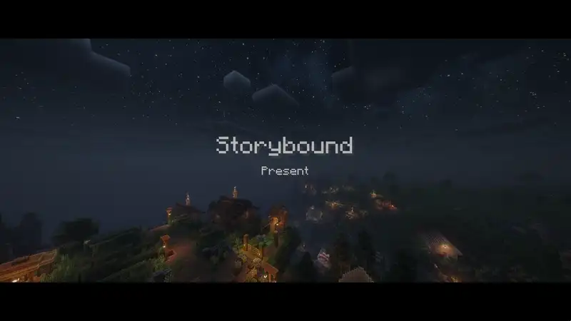{ loading=lazy }

See [Scenes](scenes.md).

### Cutscenes: anchored to the world

Cutscenes never rely on fixed coordinates. Every shot is placed relative to an anchor — the player, an NPC, an entity,
a waypoint or a structure such as `#minecraft:village` — so the same fly-by works in any generated world, wherever the
structure happens to spawn.

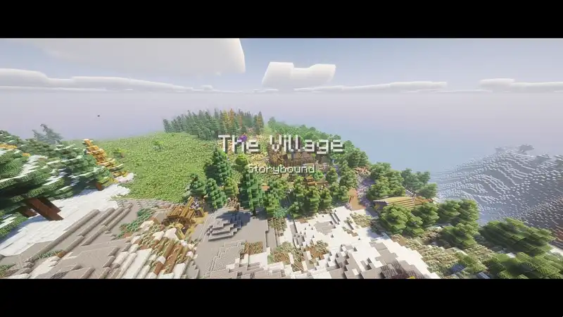{ loading=lazy }

See [Scenes](scenes.md#shots).

### Cutscene 3D editor

Build cutscenes directly inside the world without editing coordinates by hand. **3D editor** turns the editor into a
side panel over the live scene: fly the camera directly or adjust `Start`, spline `Via` points and `End` with sliders
or 3D camera handles, tune FOV, roll, easing and transitions, place titles, captions, lines, sounds, music, fades and
camera shake on the timeline, and play back a single shot or the whole scene at once.

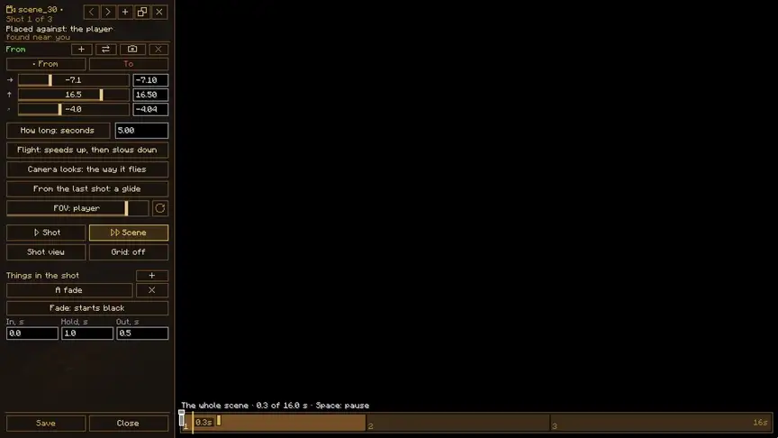{ loading=lazy }

See [Scenes in the editor](scenes.md#in-the-editor).

### Event marker

A waypoint with `"marker": "event"` shows three "!" that hop one after another, the middle one first. Use it where
something is happening: a fight, a meeting, a call for help.

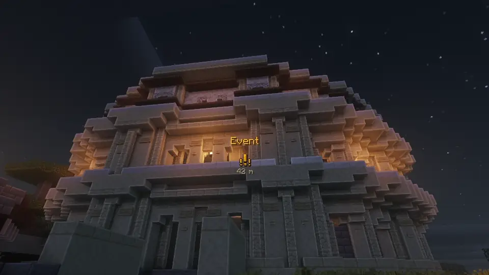{ loading=lazy }

See [Waypoints](waypoints.md).

### Question marker

A waypoint with `"marker": "question"` shows a "?" that shakes and hops now and then. Use it where something is not
known yet: a rumour, a riddle, a place to look into.

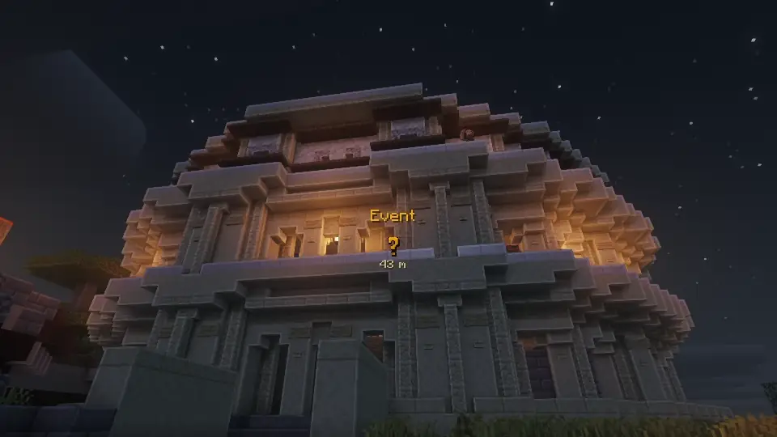{ loading=lazy }

See [Waypoints](waypoints.md).

### Trails: tracks

A trail has no icon. The player finds it on the ground and follows it. Glowing sparks rise from the steps, and only
near the player, so the trail is never seen whole. A trail can be recorded in the editor by walking it, or follow a
creature's real tracks, which show only on soft ground and break off on stone.

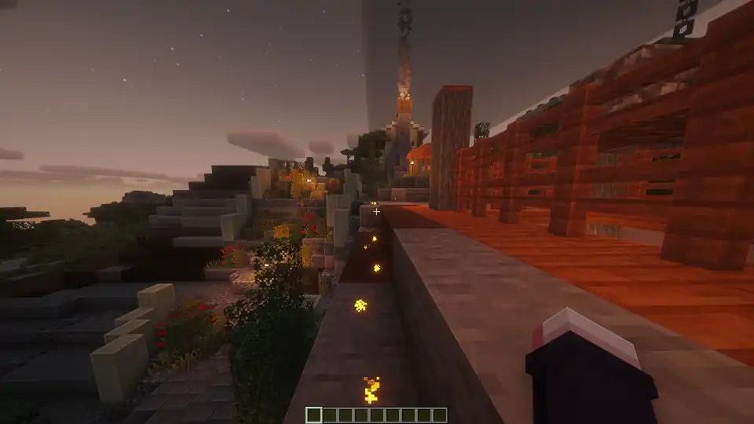{ loading=lazy }

See [Trails](waypoints.md#trails).

### Trails: scent

With `"marker": "scent"`, a trail shows its scent instead of its tracks: wisps of coloured smoke and thin glowing
strands drift along it at chest height, the way it leads, over any ground.

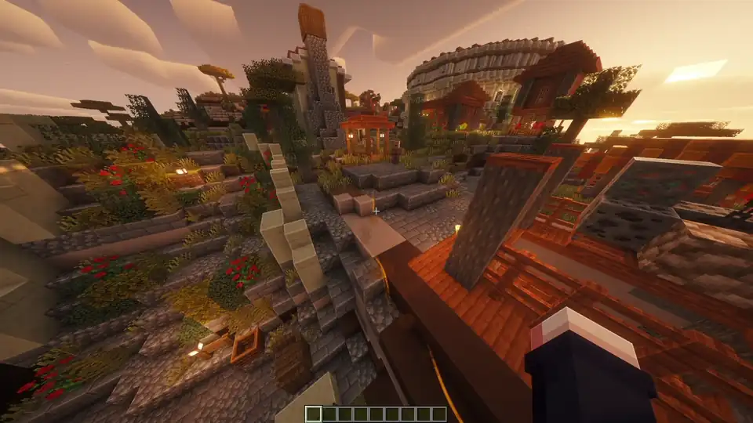{ loading=lazy }

See [Trails](waypoints.md#trails).

## Since 0.1.0

### Dialogues

NPCs talk with a cinematic camera, subtitles and answers to choose from. What they say can depend on quests, items,
reputation and anything else the story keeps track of.

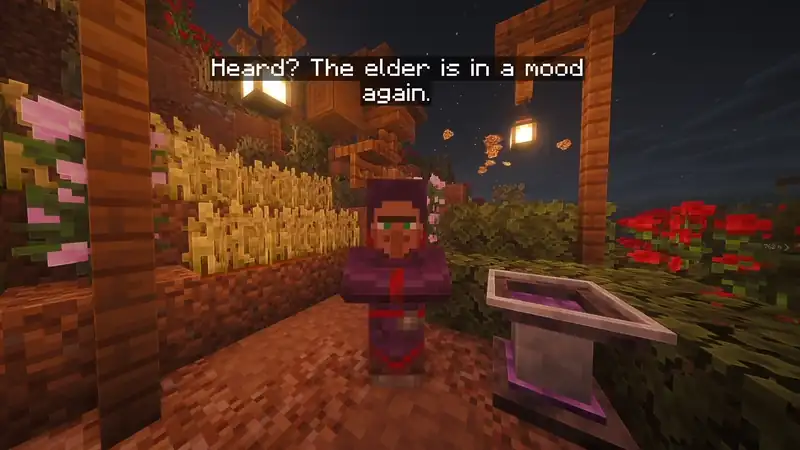{ loading=lazy }

See [Dialogues and NPCs](dialogues.md).

### Journal

Quests, documents and the Codex live in the Adventure Menu, styled as a book.

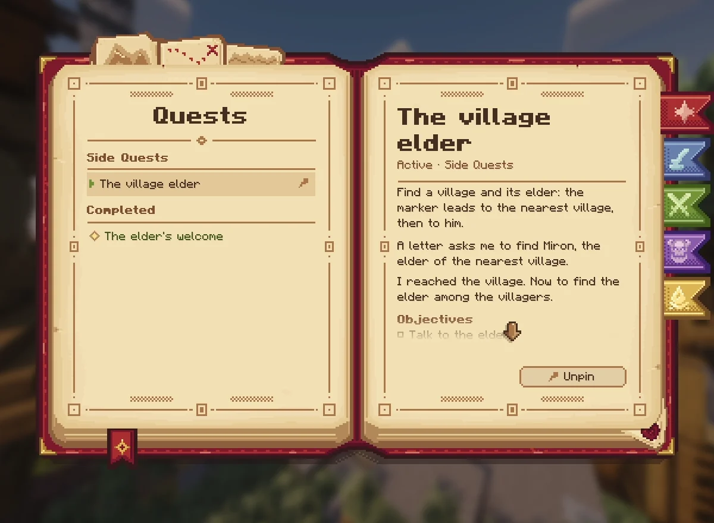{ loading=lazy }

See [Quests](quests.md) and [Documents, Codex and bosses](documents-codex.md).

### NPCs

Any mob can become an NPC, with a name, a dialogue and lines it says when players come near.

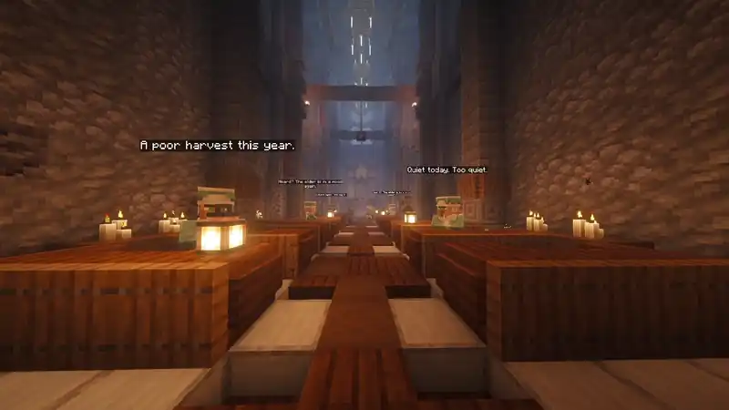{ loading=lazy }

See [Dialogues and NPCs](dialogues.md).

### Search areas

A waypoint with a radius is an area to search, as in The Witcher, with its edge drawn near the player.

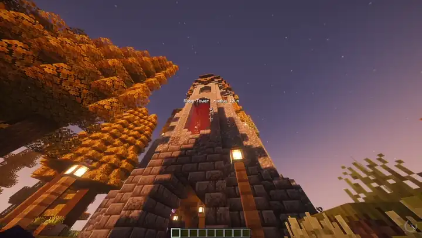{ loading=lazy }

See [Waypoints](waypoints.md).

## Credits

The villages in these clips and screenshots are from
[Epic Structures: Villages](https://modrinth.com/datapack/epic-structures-villages) by ATi.
