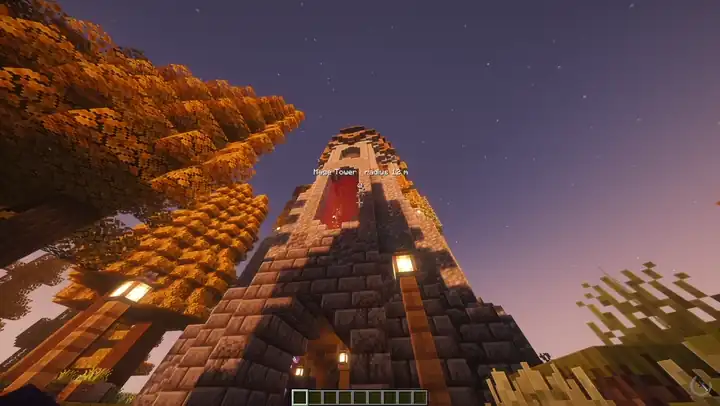

# Waypoints

Waypoints show players where to go. They are kept on the server, and each player only gets the waypoints they should
see. A waypoint shows up as a marker in the world, with an icon and the distance, and with an arrow at the edge of the
screen for the tracked quest. If Xaero's Minimap or JourneyMap is installed, the waypoints appear there too, but you
don't need a map mod.



```json
// config/storybound/my_story/waypoints/mypack/wolf_den.json
{
  "name": "mypack.waypoint.wolf_den",
  "target": { "pos": [120, 70, -340], "dimension": "minecraft:overworld" },
  "radius": 24,
  "color": "#C0392B",
  "quest": "mypack:wolf_hunt",
  "stage": "hunt"
}
```

| Field | Default | What it does |
| --- | --- | --- |
| `name` | required | The waypoint's name. |
| `target` | required | What it points at. See [Targets](#targets). |
| `radius` | 0 | Turns the waypoint into a search area of that radius instead of an exact point, as in The Witcher. |
| `show_radius` | true | For a search area, shows "radius 24 m" next to the name. |
| `show_ring` | true | For a search area, draws its edge near the player, level at the player's own height. Above the area, the edge shows up to 16 blocks over the higher of the waypoint and the ground along its edge, then fades out by 32. Below, it shows down to 30 blocks under the waypoint, enough for the foot of a tower with the waypoint on top, and is gone at 32, so from under a floating island the area up there does not show. Within the radius the marker says "Search the area" only where the edge shows whole; elsewhere it shows the distance. Turn it off when the edge would give the answer away. |
| `color` | `#E8C66A` | The colour of the marker (its icon, name, edge arrow and ring) and of the waypoint on maps. See below. |
| `marker` | `point` | `event` shows three "!" instead of the icon, the middle one larger, hopping like a cartoon, for something happening there: a fight, a meeting, a call for help. `question` shows one "?" that now and then shakes and gives a small hop, for something unknown there: a rumour, a riddle, a place to look into. A search area with either still draws its edge. A trail takes `point`, its tracks, or `scent`, see [Trails](#trails). |
| `trace` | none | Turns the waypoint into a trail, see [Trails](#trails). |
| `conditions` | none | The waypoint shows only while these hold. |
| `quest`, `stage` | none | The waypoint shows only while the quest is active, or while it is at that stage. |

Without `color`, the marker keeps its own look. Xaero's Minimap can only show Minecraft's 16 text colours, so any
other colour is shown there as the nearest one. The editor offers the 10 colours that look the same everywhere. A
dark colour is shown lighter in the world, with the same hue, so the marker can still be read at night.

## Targets

| Target | Points at |
| --- | --- |
| `{ "pos": [x, y, z], "dimension"? }` | A fixed place. |
| `{ "entity": "<uuid>" }` | One particular entity, following it as it moves. |
| `{ "structure": "#minecraft:village", "dimension"?, "search_radius"?, "origin"? }` | The nearest such structure. It is searched for in the background near each player, the way `/locate` works, and again as they travel. |
| `{ "nearest": "minecraft:wolf", "range"? }` | The nearest matching living entity around each player. It takes an id, a `#tag`, a list or a selector such as `{ "type": "minecraft:wolf", "tag": "alpha" }`. `range` is 64 blocks by default. |
| `{ "npc": "mypack:elder", "range"? }` | An NPC, by its binding. An NPC that the mod picked with `one` is followed. Otherwise it points at the nearest matching mob. |
| `{ "boss": "mypack:wraith", "range"? }` | A boss: the nearest creature that matches the boss's own `entity`. It shows nothing until the boss has been seen, and disappears once the boss is killed. |

Only entities in loaded chunks can be found. For a quest like "kill the pack leader", make the leader a boss, or spawn
it with a tag, and point the waypoint at the boss or the tag. A boss that spawned far away and that nobody has seen yet
can't be found, so until then point a waypoint at the place where it is.

A `nearest` waypoint sticks to its entity when the player walks away. When the entity can't be seen any more (its
chunk is unloaded, it is in another dimension, or the player logged in again far away), the waypoint shows the area
where it was last seen, labelled "Search the area". It becomes a point again once the entity is near. When the entity
dies, the waypoint moves on to another one. An NPC that respawns keeps its area while it waits to come back.

For a party or world quest, what one player's waypoint has found, the others see too, however far away they are.

## Trails

A trail leads the player along a way, like footprints from a farm to a cave. It has no marker at all: no icon, no
arrow at the edge of the screen and nothing on the maps. Where each step was, glowing motes in the waypoint's colour rise
now and then and fade, a step about every block, so a chain of flickering sparks shows the way. With
`"marker": "scent"` the trail shows its scent instead: wisps of coloured smoke drift along it at chest height, the way
it leads, over any ground, and thin glowing strands run quicker along it, like a scent in the air. They show only within
11 blocks of the player, so the player finds the trail and follows it and never sees it whole. A step sits on the
surface under it, never in the air, and the motes show whatever the player's particle setting is.
A trail is recorded, or found as the game goes: a creature's tracks.

**Recorded.** `trace` lists the trail's points from its start to its end, at most 512. The end is the target, which
has to be a `pos`. The steps lie at the points' own heights, on any ground.

```json
// waypoints/mypack/blood_trail.json
{
  "name": "mypack.waypoint.blood_trail",
  "target": { "pos": [140, 64, -310], "dimension": "minecraft:overworld" },
  "trace": [[120, 70, -340], [124, 69, -333], [131, 66, -322], [140, 64, -310]],
  "color": "#B33A2F",
  "quest": "mypack:missing_farmer",
  "stage": "follow"
}
```

**A creature's tracks.** With `"trace": {}` and a target that finds a creature (`entity`, `nearest`, `npc` or
`boss`), the trail is the creature's real steps of the last five minutes: where it walked, with its turns and loops.
Fresh steps near it give motes often, old ones seldom. Steps show only on ground that takes tracks, such as earth,
sand, snow or gravel, so they break off on stone. A creature that flies or swims leaves none.

```json
{ "name": "mypack.waypoint.wolf_tracks", "target": { "nearest": "minecraft:wolf" }, "trace": {} }
```

Which blocks take tracks is the block tag `storybound:takes_tracks`. A data pack can add its own blocks to it. Show
the player where a trail starts with an earlier stage, for example a search area at the farm, and end it with
something to look at, an `observed` objective.

In the editor, choose "Trail" as the kind of waypoint, then open "Points at". Rule "Recorded" gives the button
"Record it by walking": walk the trail from its start to its end, then click where it leads. The points are taken
every 2 blocks while you are on the ground or swimming, and the straight stretches are thinned out. Rule "Dynamic"
chooses whose tracks these are.

## In quests

A stage lists the waypoints it shows, with `"waypoints": ["mypack:wolf_den"]`.

By default, players only see the waypoints of quests they have pinned. Each player can change this in the client
settings with `waypoints.untrackedQuestWaypoints`: `HIDE`, `DIM` or `SHOW`. Waypoints that don't belong to any quest,
such as a person or a shared place, are always shown.

```json
// two stages of a quest
{ "id": "hunt", "waypoints": ["mypack:wolves"],
  "objectives": [ { "trigger": { "type": "entity_killed", "entity": "minecraft:wolf" }, "count": 3, "text": "mypack.quest.wolf_hunt.objective.wolves" } ] },
{ "id": "village", "waypoints": ["mypack:village"],
  "objectives": [ { "trigger": { "type": "structure_entered", "structure": "#minecraft:village" }, "text": "mypack.quest.wolf_hunt.objective.village" } ] }

// waypoints/mypack/wolves.json
{ "name": "mypack.waypoint.wolves", "target": { "nearest": "minecraft:wolf" } }
// waypoints/mypack/village.json
{ "name": "mypack.waypoint.village", "target": { "structure": "#minecraft:village" } }
```

In the first stage, the waypoint points at the nearest wolf. In the second, it points at the nearest village.

## Added by actions

The `add_waypoint` action adds a waypoint from the story. `visibility` decides who sees it: `player`, `party` or
`world`.

| Field | What it does |
| --- | --- |
| `id`, `name` | Required. Adding a waypoint with the same id and visibility replaces the old one. |
| `pos`, `dimension` | Puts it at a place. |
| `follow` | Makes it follow the entity of the moment, such as the NPC being talked to. |
| `structure`, `search_radius` | Puts it at the nearest such structure. |
| `npc`, `boss`, `nearest`, `range` | Points it at an NPC, a boss or the nearest mob, as the targets above do. |
| none of the above | Puts it where the entity of the moment stands, or the player if there is none. |
| `color`, `radius`, `marker`, `visibility` | As above. |

`remove_waypoint` takes an `id` and a `visibility`.

Operators can also share waypoints by hand:

```
/storybound waypoint add <id> <pos> <name>
/storybound waypoint remove <id>
/storybound waypoint list <player>
```

## Marker styles

All markers share one look. A resource pack can change it in
`assets/storybound/storybound/waypoint_styles/default.json` (schema `waypoint_style.schema.json`): the icons, the
size, the colours, when the name shows, and the distances at which markers fade. Every key is listed in
[Resource packs](resource-packs.md#waypoint-markers).

In the client settings, each player can make markers bigger or smaller, change their opacity, turn them off, and
choose which markers get an arrow at the edge of the screen (`waypoints.edgeArrows`).
